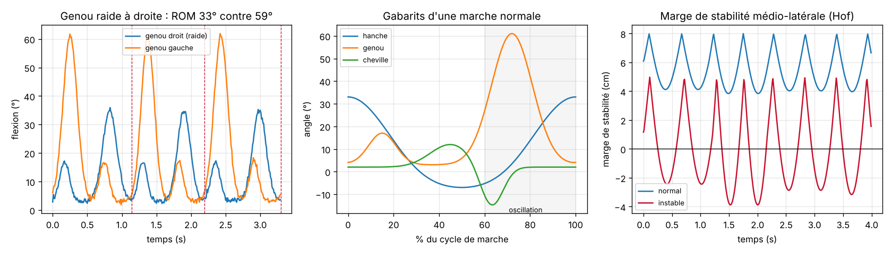

# GaitAnalysis Sim : analyse de la marche, amplitudes articulaires et stabilité

🇫🇷 [Français](#français) · 🇬🇧 [English](#english)

**Essayer la démo / Try the demo :** https://valentin-auger-laboratoire.github.io/portfolio/demos/gaitanalysis/



> Marche **simulée** à partir de gabarits simplifiés. Seuils indicatifs : ce n'est **pas un outil de diagnostic**.

---

## Français

### Le problème
En rééducation ou en suivi du vieillissement, on mesure la marche d'une personne pour répondre à trois questions :
- les articulations bougent-elles assez ? C'est l'**amplitude articulaire** (ROM, *range of motion*) ;
- la marche est-elle **symétrique** et **régulière** d'un pas à l'autre ?
- la personne est-elle **stable**, ou son centre de masse frôle-t-il le bord de ses appuis ?

### Ce que fait le code
- **Simulation** d'une marche dans le plan sagittal : angles de hanche, genou et cheville des deux côtés, foulées de durée variable, bruit de mesure, balancement latéral du centre de masse. Quatre scénarios : `normal`, `genou_raide_droit`, `variabilite`, `instable`.
- **Détection des attaques du talon** sur la flexion maximale de hanche : lissage, seuil, distance minimale entre deux pas, position affinée par une parabole.
- **ROM par cycle** pour chaque articulation et chaque côté, comparé à des ordres de grandeur d'une marche adulte.
- **Indice de symétrie** de Robinson : |D − G| / moyenne × 100.
- **Variabilité** : coefficient de variation de la durée de foulée. Au-delà de 4 %, c'est signalé.
- **Marge de stabilité** de Hof (2005) : bord de la base d'appui − (centre de masse + vitesse / ω₀), avec ω₀ = √(g / l). Une marge négative signifie que le centre de masse « extrapolé » sort de la base d'appui.

### Utilisation
```bash
python analyse.py                      # les 4 scénarios
python analyse.py genou_raide_droit
```
```
genou     droite  33.0 · gauche  58.9 · symétrie 56.4 % (repère 55–70°)  ⚠ réduite, asymétrique
...
Scénario : instable
Durée de foulée : 1.09 s · cadence 110 pas/min · variabilité 5.6 %  ⚠ élevée (> 4 %)
Marge de stabilité médio-latérale : min -3.9 cm  ⚠ négative : le centre de masse sort de la base d'appui
```

### Fichiers
| Fichier | Contenu |
|---|---|
| `demo/` | démo web (copie de celle du portfolio), avec ses tests : `node demo/tests/test.js` |
| `gaitanalysis/marche.py` | gabarits, simulation, détection des pas, ROM, symétrie, marge de stabilité |
| `analyse.py` | rapport en ligne de commande |
| `figures.py` | figure ci-dessus (matplotlib) |
| `tests/test_marche.py` | 31 vérifications : `python tests/test_marche.py` |

Les tests vérifient notamment que la détection retrouve chaque attaque du talon à moins de 15 ms même avec du bruit, que le ROM mesuré est égal à celui du gabarit, que le genou raide est repéré seulement au genou, et que la marge de stabilité calculée colle à sa valeur théorique.

### Limites
- Gabarits articulaires simplifiés, une seule dimension du balancement (médio-latéral).
- Sur de vraies données, il faudrait des capteurs (centrale inertielle ou caméra) et une détection des pas validée sur plateforme de force.
- Repères de ROM indicatifs : ils varient avec l'âge, la vitesse de marche et la personne.

Dépendance : `numpy` (et `matplotlib` pour la figure). Projet écrit en 2026.

---

## English

**Gait analysis: joint range of motion and stability.** Simulates sagittal hip, knee and ankle angles on both sides, with stride-time variability, measurement noise and mediolateral sway of the centre of mass. It detects heel strikes (smoothed hip-flexion peaks refined with a parabola), computes per-cycle ROM, Robinson's symmetry index, stride-time coefficient of variation and Hof's **margin of stability**. Four scenarios: normal, stiff right knee, high variability, unstable.

```bash
python analyse.py
python tests/test_marche.py   # 31 checks
```

**Simulated** gait, indicative thresholds: not a diagnostic tool. Requires `numpy` (`matplotlib` for the figure). Written in 2026.
